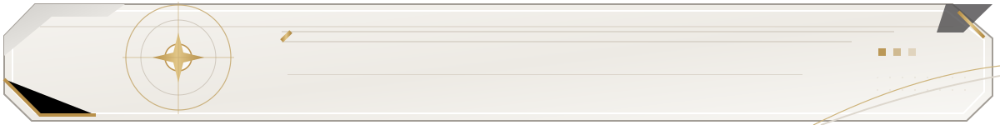
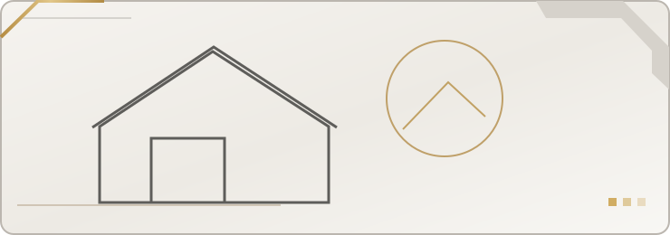

# Oh hi! I'm Vien!

**Front-End Developer &nbsp; / &nbsp; Web Development &nbsp; / &nbsp; UI/UX &nbsp; / &nbsp; System Integration**

*Per aspera ad astra.*

**[ABOUT](#about) &nbsp; · &nbsp; [SELECTED WORK](#selected-work) &nbsp; · &nbsp; [CURRENT PROJECTS](#current-projects) &nbsp; · &nbsp; [TECH STACK](#tech-stack) &nbsp; · &nbsp; [CONTACT](#contact)**

## About

I develop **web applications and integrated systems**, with a primary focus on front-end development and UI/UX implementation. My work spans responsive interfaces, back-end functionality, database design, REST API integrations, and cloud infrastructure.

I approach software development with equal attention to **how a system works and how people interact with it** — from the interface users see to the services supporting it.

## Selected Work

A selection of completed and collaborative applications. Project-specific links and documentation will be added as their public showcases are prepared.

<table>
<tr>
<td width="40%"></td>
<td valign="top">

<h3>Manson Trading</h3>

<strong>E-Commerce &amp; Inventory Management</strong>

An e-commerce application with integrated inventory workflows and AI-powered modules designed to support business operations.

<code>Web Application</code> · <code>Inventory</code> · <code>AI Integration</code>

</td>
</tr>
<tr>
<td width="40%"></td>
<td valign="top">

<h3>TrustHomePH</h3>

<strong>Bank-Acquired Property Marketplace</strong>

A marketplace and property catalogue designed to present bank-acquired real estate through an organized browsing experience.

<code>Marketplace</code> · <code>Property Catalogue</code>

</td>
</tr>
<tr>
<td width="40%"></td>
<td valign="top">

<h3>Electronic Data Interchange System</h3>

<strong>Hotel Resource Management &amp; Supply-Chain Integration</strong>

A collaborative system connecting hotel operations, retail, manufacturing, and logistics through REST APIs and automated order workflows.

<strong>Contributions:</strong> Front-end implementation, back-end integrations, API endpoints, and database functionality.

<code>REST APIs</code> · <code>Automation</code> · <code>Systems Integration</code>

</td>
</tr>
</table>

## Current Projects

| Project | Overview | Status |
|:---|:---|:---|
| **Royal Guard** | Discord server verification and management bot with a web administration dashboard. |  |
| **CampusGigs** | Service marketplace platform concept. |  |
| **Personal Portfolio** | A custom interactive portfolio built around a refined interface design system. |  |

Royal Guard is maintained in a private repository. Public demos and documentation will be linked when available.

## Technical Skills

| Domain | Technologies & Experience |
|:---|:---|
| **Languages** | JavaScript, PHP, C#, Java, HTML5, CSS3, SQL |
| **Frameworks & Libraries** | React, Laravel, Node.js, Tailwind CSS, Vite |
| **Data & Backend** | MySQL, SQLite, Firebase, REST APIs |
| **Cloud & Deployment** | AWS (EC2, S3, IAM, Route 53), Google Cloud, Vercel |
| **Development** | Git, GitHub, API Testing, Database Design, Systems Integration |

## Contact

For project inquiries or collaboration:

VIEN / DEVELOPER PROFILE

*Per aspera ad astra.*

