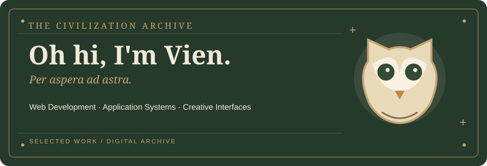

**[ABOUT](#about)** &nbsp; · &nbsp; **[WORK](#work)** &nbsp; · &nbsp; **[TECH STACK](#stack)** &nbsp; · &nbsp; **[CONTACT](#contact)**

---

I'm **Vien**, a developer focused on **front-end engineering and web applications**, with hands-on experience in back-end development, database design, REST API integration, and cloud services.

I build software with a focus on **usable interfaces, maintainable systems, and reliable connections between services**. My work spans e-commerce, property platforms, workflow automation, and server-management tools.

Beyond application development, I also work on creative interfaces and game-development projects.

> **Design with intention. Build with purpose.**

---

### Selected projects

| Project | Overview | Focus |
|:---|:---|:---|
| **Manson Trading** | E-commerce and inventory-management system with AI-integrated modules. | Commerce · Inventory · AI integration |
| **TrustHomePH** | Marketplace and catalogue for bank-acquired properties. | Marketplace · Web application |
| **Electronic Data Interchange System** | Hotel resource and supply-chain integration connecting operational components through REST APIs and automated ordering workflows. Contributions included front-end development, back-end integration, API endpoints, and database functionality. | APIs · Automation · System integration |

Selected project documentation and public showcases are being prepared. Collaborative projects are described with their scope and contributions.

### Current work

| Project | Description | Status |
|:---|:---|:---|
| **Royal Guard** | Discord verification and server-management bot with an administration dashboard. |  |
| **CampusGigs** | Service marketplace concept for discovering and connecting with providers. |  |
| **The Civilization Archive** | Original personal portfolio and interactive showcase. |  |

Royal Guard is currently a private repository; public project materials will be linked when available.

---

**Languages**

**Frameworks & Libraries**

**Data & Backend**

**Cloud & Development**

AWS: EC2 · S3 · IAM · Route 53 &nbsp; | &nbsp; Additional experience: API testing, database integration, workflow automation.

---

For collaboration and project inquiries, connect through GitHub. Additional professional contact links will be added when available.

---

**THE CIVILIZATION ARCHIVE**

*Per aspera ad astra.*

© Vien · Selected work, systems, and interfaces.

