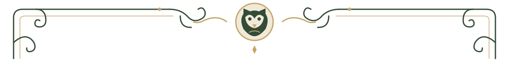

# Oh hi! I'm Vien!

**Front-End Developer &nbsp; · &nbsp; Web Applications &nbsp; · &nbsp; UI/UX &nbsp; · &nbsp; System Integration**

*Per aspera ad astra.*

THE CIVILIZATION ARCHIVE &nbsp; / &nbsp; A SELECTION OF WORK & EXPERIENCE

[About](#about) &nbsp; · &nbsp; [Projects](#projects) &nbsp; · &nbsp; [Technical Skills](#technical-skills) &nbsp; · &nbsp; [Contact](#contact)

## About

I'm **Vien**, a developer specializing in front-end and web application development, with hands-on experience in back-end functionality, databases, REST APIs, and system integration.

I build interfaces and applications with an emphasis on **clear design, reliable functionality, and practical solutions**. My experience includes e-commerce platforms, property marketplaces, automated business workflows, and administrative dashboards.

I also work on creative programming and game-development projects, combining technical implementation with an interest in how digital experiences feel to use.

## Selected Projects

*Completed and collaborative work.*

### Manson Trading
**E-Commerce & Inventory Management System**

An e-commerce platform combining online commerce, inventory-management workflows, and AI-integrated modules.

  

### TrustHomePH
**Bank-Acquired Property Marketplace**

A property marketplace and catalogue designed to organize and present bank-acquired real estate listings.

 

### Electronic Data Interchange (EDI) System
**Hotel Resource Management & Supply-Chain Integration**

A collaborative system connecting hotel operations, retail, manufacturing, and logistics through REST APIs and automated ordering workflows. My contributions included front-end development, back-end integrations, API endpoints, and database functionality.

  

Project documentation and public showcases will be linked as they become available.

### Current Work

| Project | Description | Stage |
|:---|:---|:---|
| **Royal Guard** | Discord verification and server-management bot with a web administration dashboard. |  |
| **CampusGigs** | Service marketplace platform concept. |  |
| **The Civilization Archive** | Personal developer portfolio and project showcase. |  |

Royal Guard is currently maintained in a private repository.

## Technical Skills

A selection of technologies used across my projects.

| Area | Technologies |
|:---|:---|
| **Languages** | JavaScript, PHP, C#, Java, HTML5, CSS3, SQL |
| **Frameworks & Tools** | React, Laravel, Node.js, Tailwind CSS, Vite |
| **Data & Backend** | MySQL, SQLite, Firebase, REST API Development |
| **Cloud & Deployment** | AWS (EC2, S3, IAM, Route 53), Google Cloud, Vercel |
| **Development Workflow** | Git, GitHub, API Testing, Database Design & Integration |

## Contact

For project inquiries and collaboration, you can reach me through GitHub.

Additional professional contact links will be added when available.

**THE CIVILIZATION ARCHIVE**

*Per aspera ad astra.*

Designed and maintained by Vien.

