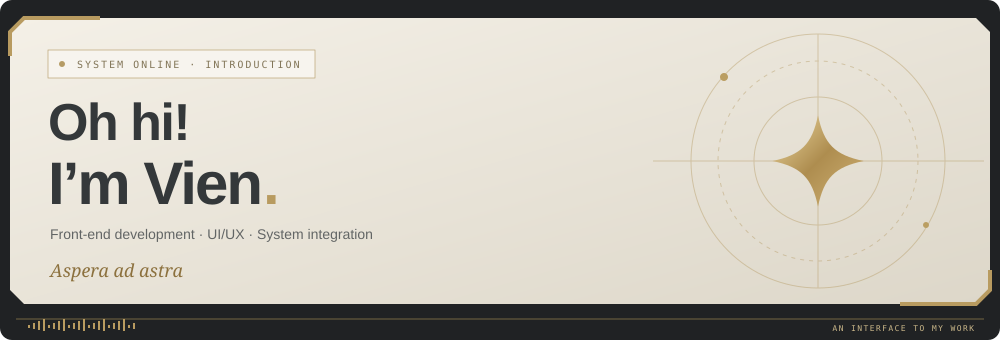
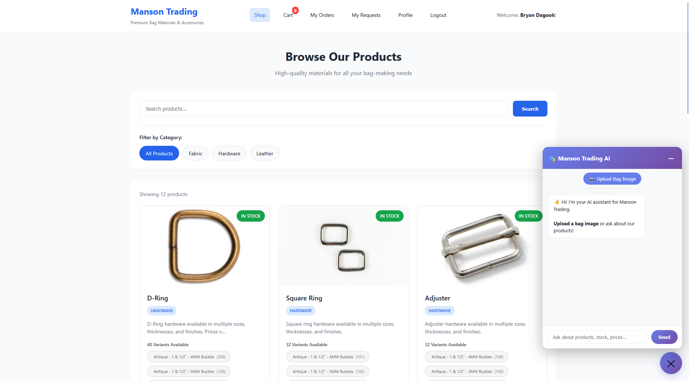
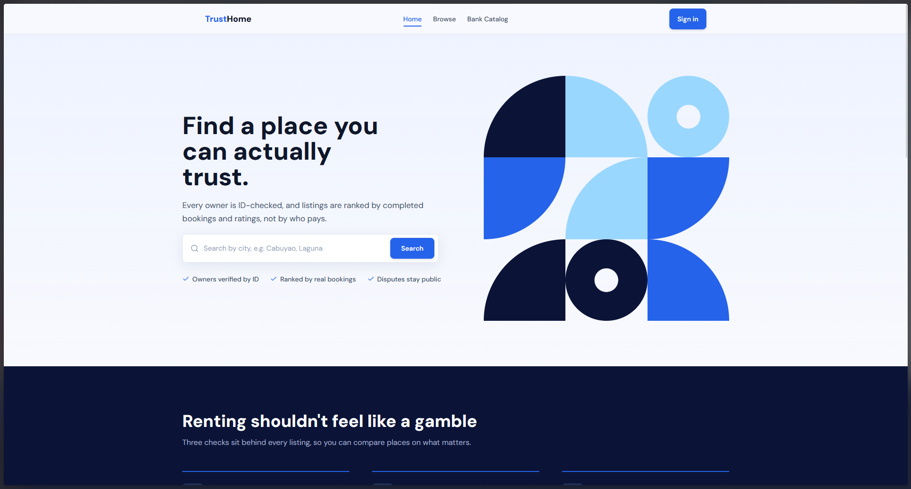
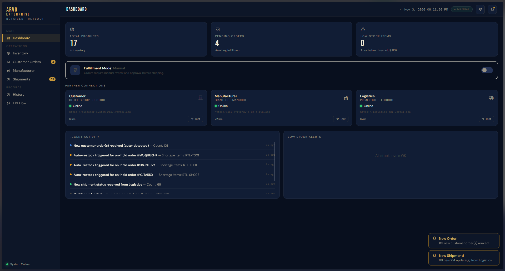
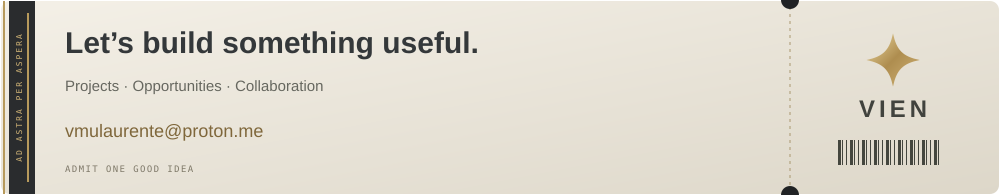

  

    

 

<h2 align="center">✦ &nbsp; About Me &nbsp; ✦</h2>

I'm **Vien**, a developer focused on building **web applications, responsive interfaces, and integrated systems**. Front-end development is where I spend most of my time, but my project experience also includes server-side development, database design, REST API integrations, and deployment.

I enjoy working across both the **visual and technical sides of software**. A good interface should make complex functionality approachable, while the system behind it should remain dependable, maintainable, and purposeful. That balance is what I aim for in the applications I build.

My projects include **e-commerce and inventory management, property catalogues, hotel supply-chain integration, and Discord administration tools**. I also have experience in game development and enjoy applying ideas from interactive media to interface design.

 

 

<h2 align="center">✦ &nbsp; Selected Work &nbsp; ✦</h2>

APPLICATIONS &nbsp; ✦ &nbsp; SYSTEMS &nbsp; ✦ &nbsp; COLLABORATIVE PROJECTS

 

<table width="100%">
<thead><tr><td colspan="4" height="1" style="padding:0"></td></tr><tr><th colspan="2" align="left">Project</th><th align="center">Source Code</th><th align="center">Live View</th></tr></thead>
<tbody>
<tr>
<td width="20%" valign="middle"></td>
<td width="48%" valign="middle"><strong>Manson Trading</strong> E-Commerce &amp; Inventory Management
E-commerce application with integrated inventory workflows and AI-powered modules for business operations.
Commerce ✦ Inventory ✦ AI integration</td>
<td width="16%" align="center" valign="middle"><a href="https://github.com/venuine/manson-trading">Source Code</a></td>
<td width="16%" align="center" valign="middle">Not available yet</td>
</tr>
<tr>
<td width="20%" valign="middle"></td>
<td width="48%" valign="middle"><strong>TrustHomePH</strong> Bank-Acquired Property Marketplace
Marketplace and property catalogue for browsing and organizing bank-acquired real estate.
Marketplace ✦ Web Application</td>
<td width="16%" align="center" valign="middle"><a href="https://github.com/carilloandrei9264/team-idle">Source Code</a></td>
<td width="16%" align="center" valign="middle"><a href="https://trusthome-ph.web.app/">Live View</a></td>
</tr>
<tr>
<td width="20%" valign="middle"></td>
<td width="48%" valign="middle"><strong>Electronic Data Interchange System</strong> Hotel Resource &amp; Supply-Chain Integration
Collaborative hotel resource-management system connecting retail, manufacturing, and logistics through REST APIs and automated order workflows.  <strong>My contributions:</strong> Front-end implementation, back-end integration, API endpoints, and database functionality.
REST APIs ✦ Automation ✦ Integration</td>
<td width="16%" align="center" valign="middle"><a href="https://github.com/venuine/edi-retailer-demo">Demo Source</a></td>
<td width="16%" align="center" valign="middle"><a href="https://venuine.github.io/edi-retailer-demo/">Live View</a></td>
</tr>
</tbody>
</table>
Source Code and Live View fields are reserved for verified, shareable project links. Some work belongs to collaborative repositories or has no public deployment. The project previews are screenshots of the applications.

 

 

<h2 align="center">✦ &nbsp; Current Projects &nbsp; ✦</h2>

<table width="100%">
<thead><tr><td colspan="3" height="1" style="padding:0"></td></tr><tr><th width="22%" align="left">Project</th><th width="58%" align="left">Overview</th><th width="20%" align="center">Stage</th></tr></thead>
<tbody>
<tr><td><strong>Royal Guard</strong></td><td>Discord verification and server-management bot with a web dashboard.</td><td align="center"></td></tr>
</tbody></table>

Royal Guard's repository is currently private. Public demos will be linked when available.

 

 

<h2 align="center">✦ &nbsp; Technical Skills &nbsp; ✦</h2>

TECHNOLOGIES USED IN DEVELOPMENT, INTEGRATION &amp; DEPLOYMENT

 

<table width="100%"><tr><td colspan="2" height="1"></td></tr><tr><td width="19%" valign="middle"><strong>FRONT-END</strong></td><td width="81%" valign="middle">     </td></tr>
<tr><td width="19%" valign="middle"><strong>BACK-END</strong></td><td valign="middle">   </td></tr>
<tr><td width="19%" valign="middle"><strong>DATA & CLOUD</strong></td><td valign="middle">     </td></tr>
<tr><td width="19%" valign="middle"><strong>LANGUAGES</strong></td><td valign="middle"> </td></tr>
<tr><td width="19%" valign="middle"><strong>WORKFLOW</strong></td><td valign="middle">    </td></tr></table>

AWS experience includes EC2, S3, IAM, and Route 53. Additional experience includes API testing and database integration.

 

 

<h2 align="center">✦ &nbsp; Goals & Future Direction &nbsp; ✦</h2>

My goal is to create **useful, well-designed software that makes a meaningful difference to the people using it**. I want to contribute to professional development teams, take responsibility for larger projects, and keep improving how I design, develop, and maintain complete applications.

Over the longer term, **I want to create games of my own**, bringing what I've learned from front-end development, UI design, and user interaction into gameplay interfaces and player experiences. I see web applications and games as two different opportunities to solve design problems, communicate information, and build something people enjoy using.

I also want to work on a wide range of **products and services that benefit other people**. Whether that's a practical business platform, a tool that simplifies everyday work, or an interactive experience, I want to develop ideas into products with a clear purpose and real users.

 

 

<h2 align="center">✦ &nbsp; Contact &nbsp; ✦</h2>

 

For project inquiries, collaboration, or professional opportunities:

 

 

<a href="mailto:vmulaurente@proton.me">vmulaurente@proton.me</a>
  

VIEN &nbsp; ✦ &nbsp; DEVELOPER PROFILE

**Journey Well.**

